# Overtone

Custom firmware for the **Elektron Digitone II** (OS 1.12) that adds new machines, per-track effects and a lot more
modulation, while keeping your projects in Elektron's format.

- **Four new machines:** SOPHIE, MACHINEDRUM, LOOP and THRU
- **An insert effect on every track:** flanger, phaser, chorus or reverb
- **Envelope followers**, a **second arpeggiator** that works as a step modulator, and an arp that plays in your scale
- **GROOVE**, a step-by-step timing editor that replaces swing
- **Instant pattern switching** that keeps your place in the bar
- **Parameter slides**, and knobs that show what is actually playing
- Arps, LFOs and followers on **MIDI tracks** too

You build Overtone yourself from Elektron's own OS file, in your browser. No Elektron firmware is shared here.

**Overtone is not made or supported by Elektron.**

<a href="https://buymeacoffee.com/complexping"></a>

**Contents:** [Install](#install) · [The machines](#the-machines) · [Effects](#insert-effects) ·
[Modulation](#modulation) · [Timing and patterns](#timing-and-patterns) · [Going back](#going-back-and-recovery) ·
[Good to know](#good-to-know) · [Credits](#credits)

*Screenshots are from Overtone running in an emulator.*

## Install

You need a Digitone II, a USB cable and **Elektron Transfer**.

1. **Download Elektron's OS 1.12** (`Digitone_II_OS1.12_dist.zip`) from
   [Elektron's download page](https://elektron.se/support-downloads/digitone-ii). Keep it somewhere safe: Elektron only
   lists the latest OS, and you need this file to go back or to build again.
2. **Build Overtone** in the [Overtone builder](https://complex-ping.github.io/overtone/): drop the .zip on the page and
   press **Make**. Everything runs in your browser and nothing is uploaded. It only accepts the original OS 1.12 and
   only saves a file that matches the tested build exactly.
3. **Send it** to the Digitone with Transfer: drag the `.syx` onto it, press **YES** on the Digitone and wait for it to
   restart.

<details>
<summary>Prefer the command line?</summary>

With Python 3.11 or later, download Overtone from [Releases](../../releases), unzip it and run:

```bash
python3 patcher/patch.py ~/Downloads/Digitone_II_OS1.12_dist.zip
```

It writes the same file next to the .zip. The unzipped folder or the .syx work as input too.
</details>

## The machines

Choose them like any other machine: **[FUNC] + [SYN]** on a track.

### SOPHIE

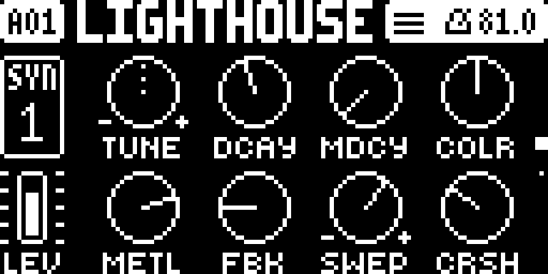 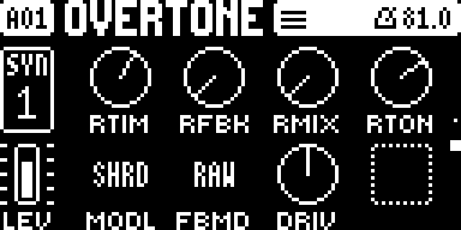

Metallic percussion, pipes and punchy kicks, ported from Matt Estela's **Schwung Sophie**. Seven models (FUSE, STAK,
SPLT, SHRD, PIPE, BOOM, KICK) on page 2, with feedback and drive. It has no filter of its own, so shape it
with the track's filter.

### MACHINEDRUM

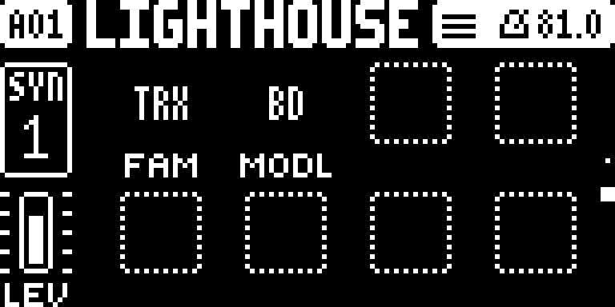 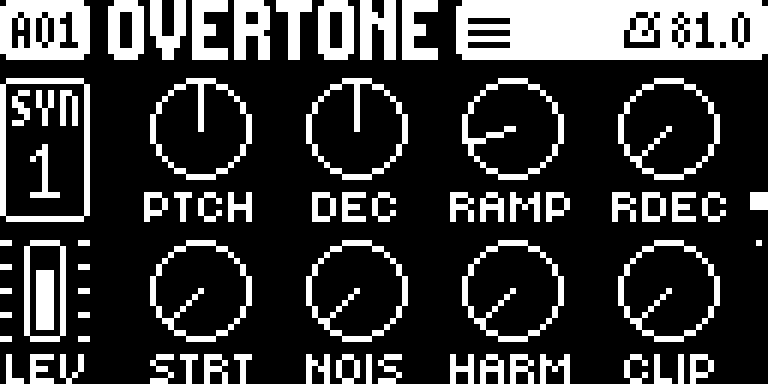

Three of the **Machinedrum's** synthesis families, ported from its own sound engines:
- **TRX:** BD B2 SD RS XT XC CP MA CB CL CH OH CY
- **EFM:** BD SD XT CP RS CB HH CY
- **P-I** (physical models): BD SD MT ML MA RS RC CC HH

Pick the family (**FAM**) and model (**MODL**) on page 2; page 1 has the model's eight knobs, named as on the
Machinedrum. Play notes above or below C4 to transpose.

MACHINEDRUM is polyphonic: a new note doesn't cut the one still ringing, and every voice runs its own engine. **Unison**
works as on the other machines (VOICE menu: STATE, V.AMNT, SPREAD), each unison voice a full engine. Picking MACHINEDRUM
in the machine menu switches the track's unison off; turn it back on in the VOICE menu.

### LOOP

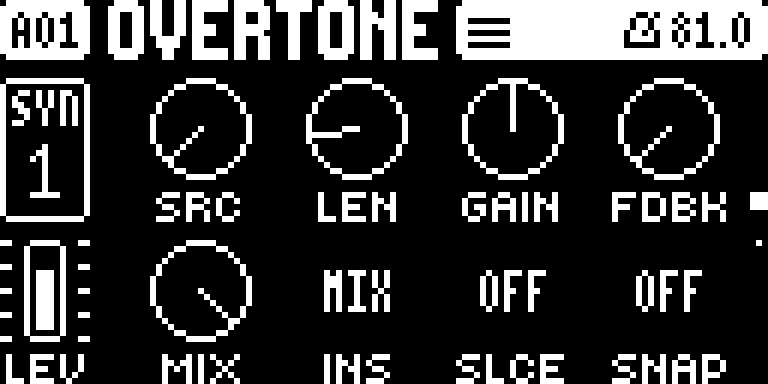 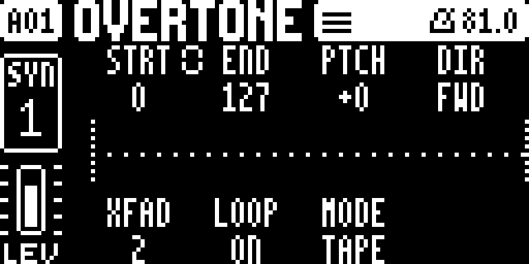

A looper inspired by the Machinedrum's RAM machines. It is always recording (8 seconds of stereo per track), and a trig
plays back what it caught, at the trig's pitch.

- **SRC** picks what it records: a track, **MAIN** (the whole mix), **IN** (the audio inputs), **USB**, or **CUST**
  (push knob A to pick any mix of tracks, inputs, send effects and USB). **OFF** freezes the buffer but keeps it in
  time, so turning the source back on lands on the beat. SRC can be p-locked.
- **LEN** sets the length (hold [FUNC] for 4, 8, 16, 32 … 128 steps). **FDBK** overdubs, **MIX** fades from the source
  to the loop, **SLCE** cuts the take into slices played by note.
- **Page 2** shows the waveform. Set start, end, pitch and direction; push A or B to link start and end into a moving
  window. **TAPE** mode ties speed to pitch, **STRC** time-stretches so they're independent. Hold [FUNC] while turning
  SPED or PTCH to jump between musical ratios and intervals.

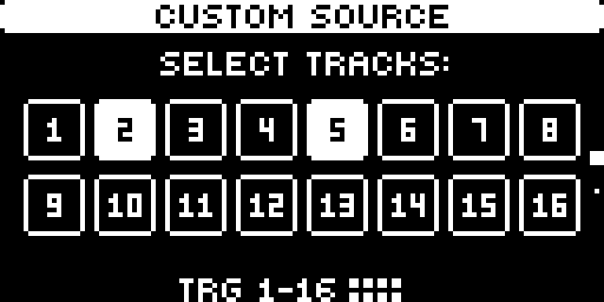 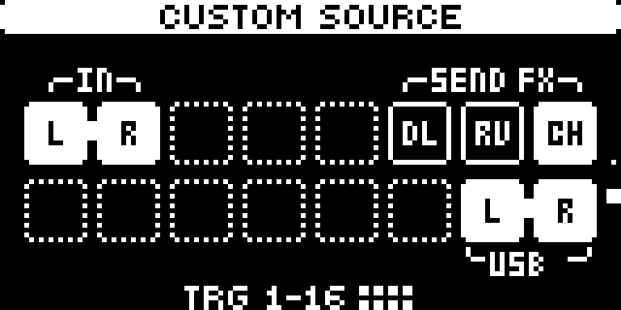

### THRU

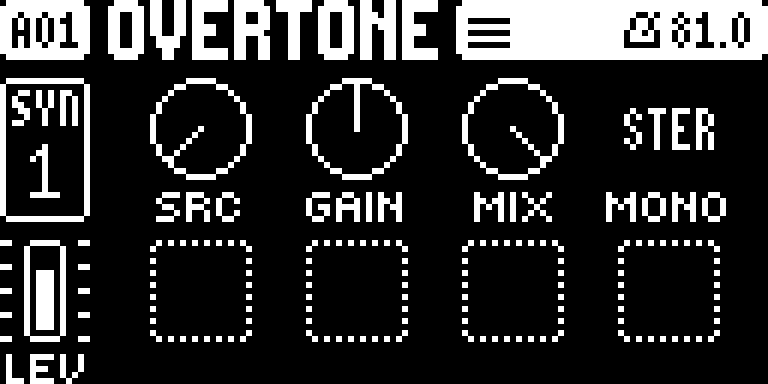

Plays **another track's output** through this track's overdrive, filter, amp, pan and insert. **SRC** picks the track
(or CUST, as on LOOP), **GAIN** the level, **MIX** fades from the original to the processed sound, and **MONO** chooses
stereo or mono.

## Insert effects

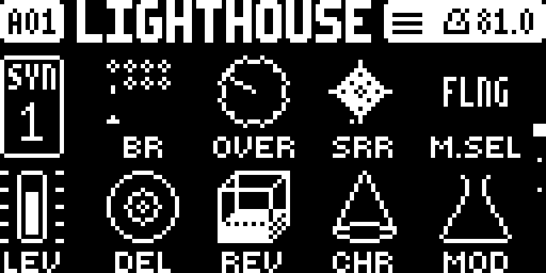 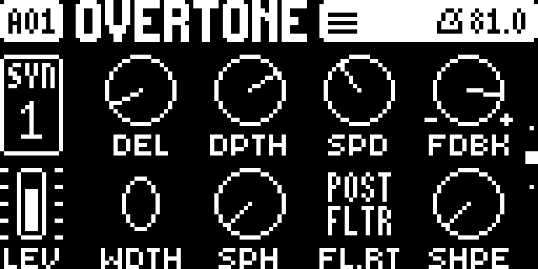

Every track gets its own effect, on top of the shared delay, reverb and chorus.

- **[FX] page 1:** **M.SEL** picks **FLNG**, **PHSR**, **CHOR** or **REVB**, and **MOD** sets the dry/wet. Both can be
  p-locked, so a single trig can switch effects.
- **[FX] page 2:** the effect's knobs. **FL.RT** places it before the filter (in stereo; the track then uses two voices
  per note) or after the pan.
- **[FX] page 3:** move the stock bit reduction and overdrive before or after the filter.

The flanger is an original design; the phaser, chorus and reverb are ports of the Monomachine's.

## Modulation

### Envelope followers

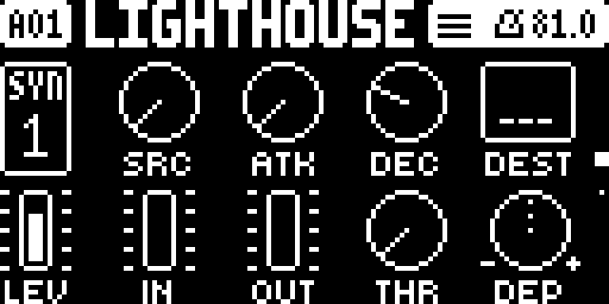 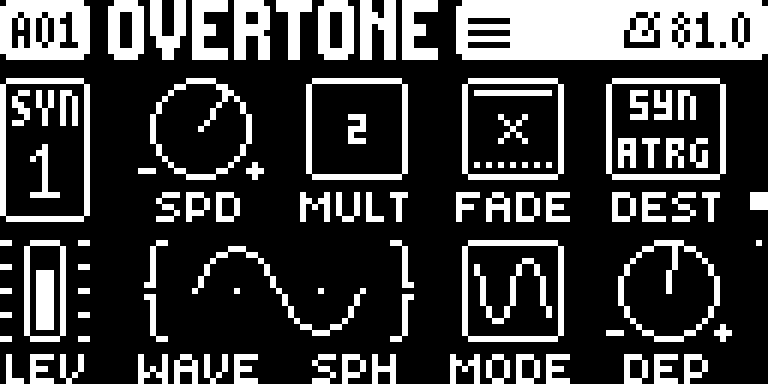

Two per sound. On a **[MOD]** page press **RIGHT** to reach them (UP / DOWN switches follower, LEFT goes back to the
LFOs). A follower listens to a track, the main mix, the inputs, USB or a custom mix, and moves any parameter you pick in
**DEST**. Set how fast it reacts (**ATK**, **DEC**), the threshold (**THR**) and the depth (**DEP**, positive or
negative). Every knob can be p-locked.

### Two arpeggiators

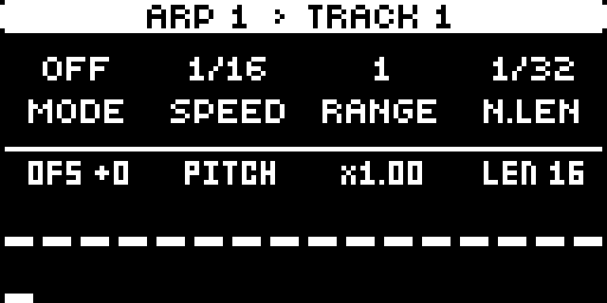 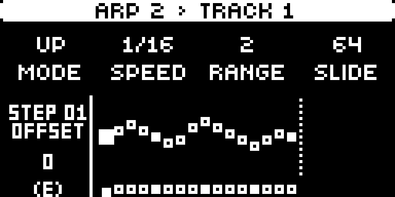

Tap **[ARP]** in the arp menu to switch between them.

- **ARP 1** is the stock arpeggiator with more to it. Each step has an offset (**OFS**) and can be muted (UP / DOWN).
  With **DEST** on PITCH it plays in the keyboard scale and **DEP** stretches or flips the pattern; on any other DEST
  the note stays and the steps move that parameter instead.
- **ARP 2** plays no notes: it is a step modulator. It restarts on every trig and moves its DEST by each step's value.
  **RANGE** scales the steps (×1 to ×8), and **SLIDE** glides smoothly from one step to the next. On PITCH it adds
  scale steps to ARP 1's notes.
- **New modes:** **SHUF** plays the notes in a random order and repeats it, **RAND** picks a random note each step, and
  **FREE** runs the arp like a sequencer from the pattern start, without needing trigs.
- **SPEED** goes up to 1/128.
- **Hold [ARP] + [YES]** to randomize. In grid recording, hold a trig and turn the ARP knobs to lock them to that trig.

### Cross-modulation

The LFOs, envelope followers and arps can all modulate each other's knobs: LFO1 can wobble ARP 1's speed, ARP 2 can step
a follower's depth, and so on. You'll find them in the DEST lists after SYN and FX.

### MIDI tracks

MIDI tracks get both arps, the LFOs and both followers too. ARP 1 sends its notes over MIDI in the keyboard scale, and
any modulation can target pitch bend, aftertouch, mod wheel, breath or the track's CC values.

## Timing and patterns

### GROOVE

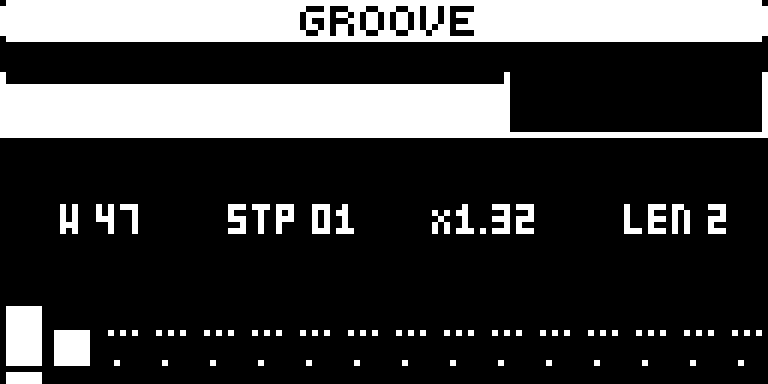 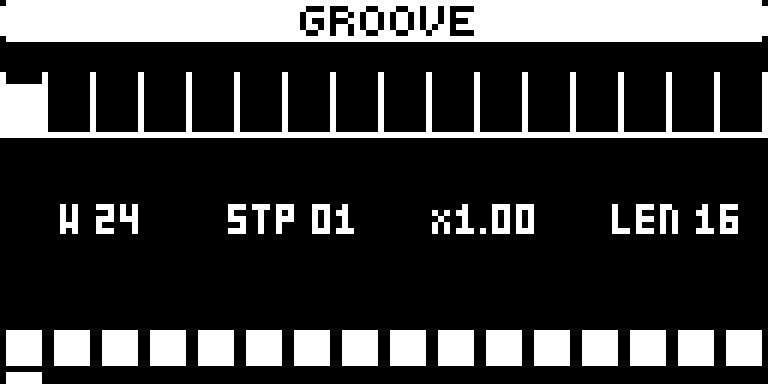

Press **[TEMPO] twice** to open GROOVE. It replaces swing: every step in a cycle gets a weight that makes it longer or
shorter, while the cycle as a whole stays in time.

- **LEFT / RIGHT** choose a step, **E** or **UP / DOWN** set its weight (24 is straight).
- **F** picks a preset: straight, Elektron-style swing from 54 to 71 % on 16ths or 8ths, plus PUSH, SHFL, LAZY and QUIN.
- **G** adds **DRIFT**, a fresh random nudge every cycle. It is also a modulation destination.
- **H** sets the cycle length (1–16 steps).
- **Hold [TEMPO] + [YES]** for a random groove.

GROOVE moves every step on every track, including the arps and micro timing. It is saved with the pattern and also
works when the Digitone follows an external MIDI clock.

**Swing settings:** to match any Elektron swing value, set LEN 2, step 1 to half the percentage and step 2 to 50 minus
that (60 % = 30 and 20).

### Instant pattern switch

Hold **[PTN]** and press **[YES]** to turn it on (**[NO]** turns it off). A new pattern then starts at the next step
instead of at the end of the bar, and at the position it would have reached if it had been playing all along, so you
never lose the beat. Chains, songs and program changes still switch at the end of the pattern. The setting is saved
with the project.

### Parameter slides

On **TRIG page 2**, turn on **SLD** and set **SLEN** (in steps). The trig's values then glide in from where the track
was, insert effects included. Lock trigs slide too, so you can glide parameters without a new note.

### Knobs that show what is playing

While the sequencer runs, the knobs show the live value, including p-locks, slides and modulation. Hold a page key to see
the values you set. To turn this off, set **[SETTINGS] > SYSTEM > LIVE KNOBS** to OFF: the knobs then show the stored
values, as on Elektron's OS. The setting is kept over power cycles and project loads.

## Going back and recovery

- **Back to Elektron's OS:** send `Digitone_II_OS1.12.syx` (inside Elektron's .zip) with Transfer. Overtone installs it
  without asking for YES.
- **Updating:** send the new Overtone build the same way.
- **On Overtone 1.0?** Transfer can't update it. Go back to Elektron's OS through the STARTUP menu below first.
- **If the Digitone won't start:** hold **[FUNC]** while switching it on, press **[TRIG 4]** (OS UPGRADE), and send
  Elektron's `.syx` in Transfer's **LEGACY OS UPGRADE** mode over a **DIN MIDI** cable (USB doesn't work here). It takes
  about 15 minutes. Overtone never touches this startup menu.

## Good to know

- **OS 1.12 only.** The builder refuses any other file.
- **Projects** stay in Elektron's format. Opening Overtone projects on Elektron's OS isn't tested, so keep a copy.
- **Swing is gone.** Saved swing is ignored; use GROOVE instead.
- **DSP load:** LOOP, SOPHIE and MACHINEDRUM cost more than the stock machines. If the audio crackles, check
  **[SETTINGS] > SYSTEM > DSP LOAD** and use fewer voices.
- **GROOVE** is global for now (per track is planned). Tempo-synced LFOs and delays follow the BPM, not the groove.
- **Overbridge** only knows Elektron's parameter names and ranges.

## How it's made

Overtone was developed with [Claude Code](https://claude.com/claude-code) and the
[digitone-2-modding-skill](https://github.com/complex-ping/digitone-2-modding-skill). Every build passes about 190
checks in two emulators (the Digitone's main OS in [digikit](https://github.com/m-dwyer/digikit) and its DSP in a SHARC
emulator) before it is tried on a real unit.

The patcher holds only Overtone's own code plus instructions for copying from your file; none of Elektron's bytes are in
it.

## Credits

- **[dnfw](https://github.com/angellinares/dn2_firmware_explore)** (angellinares): the firmware container, code loader
  and C build path. `patcher/_dnfw` is its code, unchanged.
- **[elektron-firmware-tool](https://github.com/mischa85/elektron-firmware-tool)** (Marcel Bierling): the container
  format dnfw follows.
- **[digikit](https://github.com/m-dwyer/digikit)** (Em D): the ColdFire emulator every build is tested in.
- **[Schwung Sophie](https://github.com/mestela/schwung-sophie)** (Matt Estela, digisophie contributors; MIT): the
  SOPHIE machine.
- **[gearmulator](https://github.com/dsp56300/gearmulator)**: its DSP56300 emulator ran the Machinedrum and Monomachine
  references.
- **Elektron's Machinedrum and Monomachine**: the MACHINEDRUM machine and the PHSR, CHOR and REVB effects are ports of
  their sound engines.
- [naturarum/dn2-cfw](https://github.com/naturarum/dn2-cfw) (Digiwerk) showed how to ship Digitone II firmware as a
  patcher.

Made by [complex-ping](https://github.com/complex-ping) with Claude, Anthropic's AI model, in Claude Code.

## Licence

AGPL-3.0-or-later (the patcher includes dnfw, which is AGPL). See [LICENSE](LICENSE).

Elektron, Digitone, Machinedrum, Monomachine and Overbridge are trademarks of Elektron Music Machines. Overtone is not
made or supported by Elektron, and not affiliated with or endorsed by it.
