# Overtone

**Overtone** is custom firmware for the **Elektron Digitone II**, built on OS 1.12. It adds:
- four new machines: **SOPHIE**, **MACHINEDRUM**, **LOOP** and **THRU**;
- per-track insert effects;
- envelope followers, a second arpeggiator that works as a step modulator, and an arpeggiator locked to the scale;
- parameter slides and knobs that show what is playing;
- GROOVE, a step-by-step timing editor that replaces swing, with presets, random grooves and a modulatable drift.

You make the build yourself: the patcher here turns Elektron's own OS 1.12 file into Overtone on your computer, and you
send the result to the Digitone with Elektron Transfer. No Elektron firmware file is shared here.

**Not made or supported by Elektron.**

- [What's in it](#whats-in-it)
- [Install](#install)
- [Going back, and recovery](#going-back-and-recovery)
- [Compatibility](#compatibility)
- [Known limitations](#known-limitations)
- [How it's made and tested](#how-its-made-and-tested)
- [Credits](#credits) and [licence](#licence)

The screens below are taken from Overtone running in an emulator.

## What's in it

Pick the new machines like any other: **[FUNC] + [SYN]** on a track.

### SOPHIE

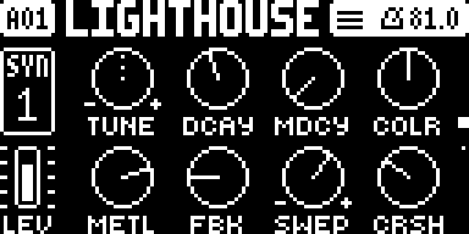 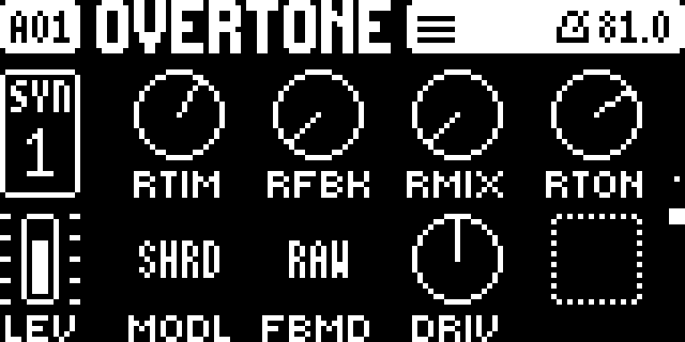

Percussive metal, pipes and kicks: a port of Matt Estela's **Schwung Sophie** synth.
- **Page 1:** **TUNE DCAY MDCY COLR** / **METL FBK SWEP CRSH**.
- **Page 2:** **RTIM RFBK RMIX RTON** / **MODL** (FUSE, STAK, SPLT, SHRD, PIPE, BOOM, KICK), **FBMD** (RAW / SMTH),
  **DRIV**.
- It has no filter of its own: use the track's filter.

### MACHINEDRUM

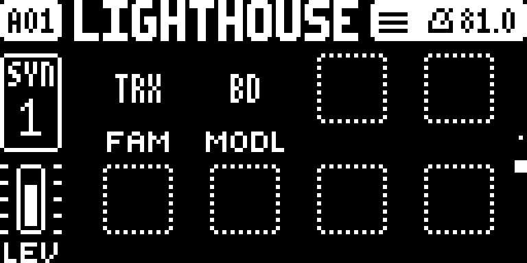 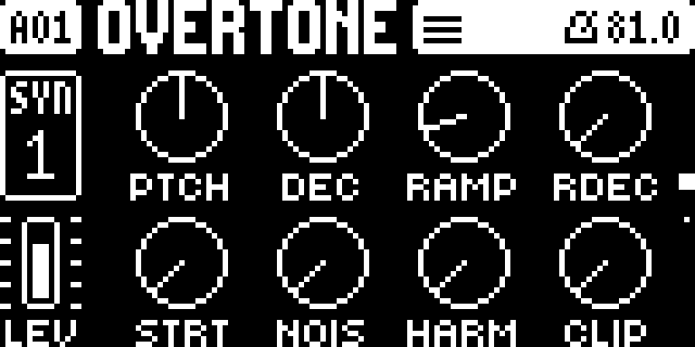

Three of the **Machinedrum's** synthesis families in one machine, ported from its own sound engines.
- **Page 2:** **FAM** picks the family, **MODL** the model.
  - **TRX:** BD B2 SD RS XT XC CP MA CB CL CH OH CY.
  - **EFM:** BD SD XT CP RS CB HH CY.
  - **P-I** (physical models): BD SD MT ML MA RS RC CC HH.
- **Page 1:** the model's 8 knobs, labelled as on the Machinedrum.
- Notes above or below C4 transpose it.

### LOOP

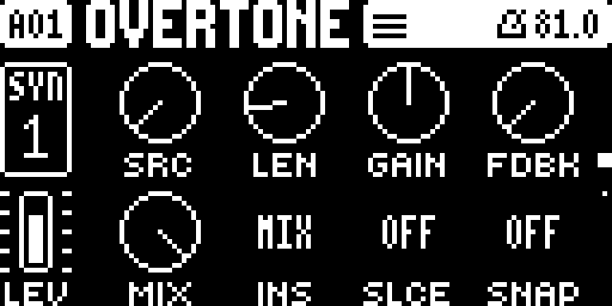 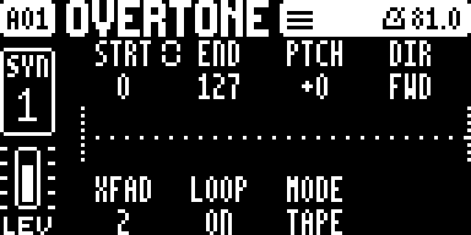

A looper on a synth track, after the Machinedrum's RAM machines. It records all the time (8 seconds per track, stereo).
A trig plays what it has, at the trig's pitch. Selecting LOOP on an empty track puts a 16-step trig on step 1.
- **Page 1:**
  - **SRC:** what it records: a track (**T1**–**T16**), **MAIN** (the mix) or **IN** (the audio inputs, after the
    external mixer), or **OFF** (freezes the buffer).
  - **LEN:** the take's length. **GAIN**, and **FDBK** (overdub).
  - **MIX:** crossfades the source into the loop. **INS:** **MIX** replaces the source, **LAYR** plays the loop on top
    of it.
  - **SLCE:** cuts the take into slices, played by note (C4 = the first slice). **SNAP:** start and end move in steps.
- **Page 2 ([SYN] again): the buffer.** The waveform, where it records and where it plays. **STRT END PTCH DIR** /
  **XFAD LOOP MODE SPED**.
  - **MODE TAPE:** speed follows pitch. **STRC:** time-stretch, so pitch (**PTCH**, ±36 semitones) and speed (**SPED**)
    are separate.
  - Push **A** or **B** to link start and end: the chain icon joins and END becomes the window size.
  - Hold **[FUNC]** while turning **SPED** to step through ratios (×1, ×1.5, ×2 …), or **PTCH** to step through fifths
    and octaves.

### THRU

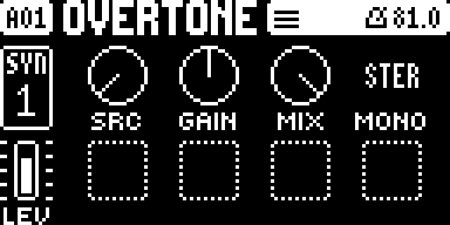

A machine whose sound is **another track's output**, sent through this track's own overdrive, filter, amp, pan and
insert.
- **SRC:** the source track (by default the one on the left).
- **GAIN:** the level (64 = unchanged).
- **MIX:** crossfades from the source to THRU. At 127 only THRU is heard, including the source's delay and reverb sends.
- **MONO:** **STER** (stereo) or **MONO**.

### Insert effects on every track

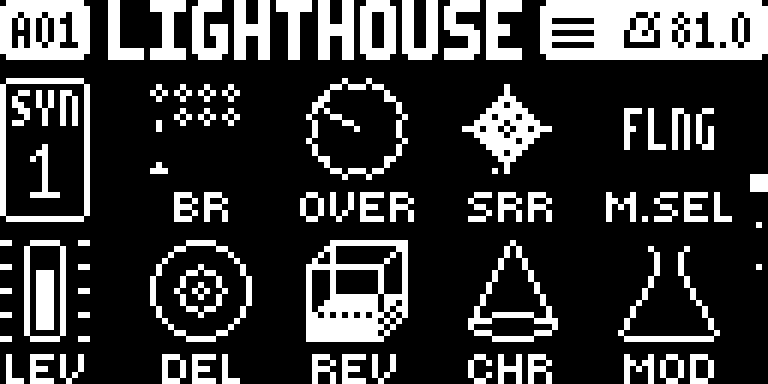 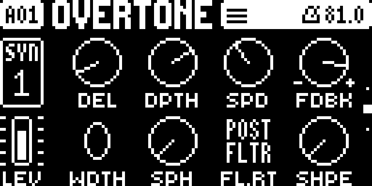

Every track gets its own insert effect, on top of the shared delay, reverb and chorus. Each insert has its own settings
and p-locks, and LFOs and envelope followers can modulate it.
- **[FX], first page:**
  - **D M.SEL** picks the insert: **FLNG** (flanger), **PHSR** (phaser), **CHOR** (chorus) or **REVB** (reverb).
  - **H MOD** is the insert's dry/wet.
  - Both can be p-locked, so one trig can switch to another effect.
- **[FX], second page: the insert's knobs.**
  - FLNG, PHSR and CHOR: **DEL** (or CNTR), **DPTH**, **SPD**, **FDBK** / **WDTH** (stereo width), **SPH** (or LP),
    **FL.RT**, **SHPE**.
  - REVB: **DEC DAMP GATE PDLY** / **LP HP MODD WDTH**.
  - **FL.RT** routes the insert **PRE FLTR** (before the filter, in stereo: the track takes two voices per note) or
    **POST FLTR** (after the pan).
- **[FX], third page:** **SR.RT** and **OD.RT** put the stock bit reduction and overdrive before or after the filter.

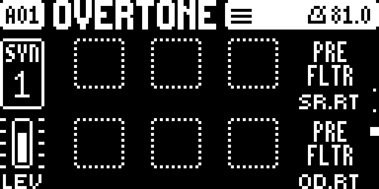

FLNG is an original design. PHSR, CHOR and REVB are ports of the Monomachine's effects.

### Envelope followers

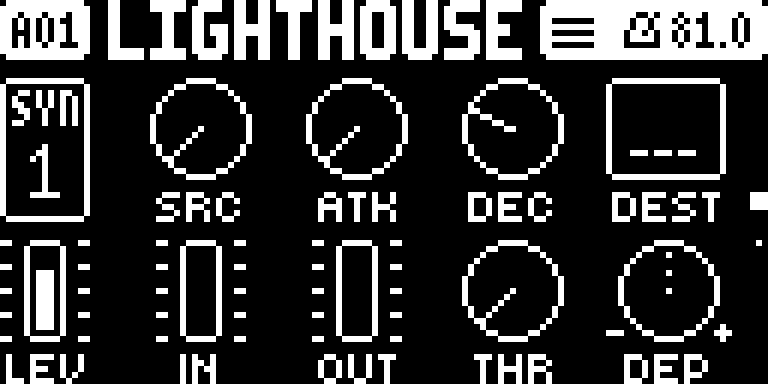 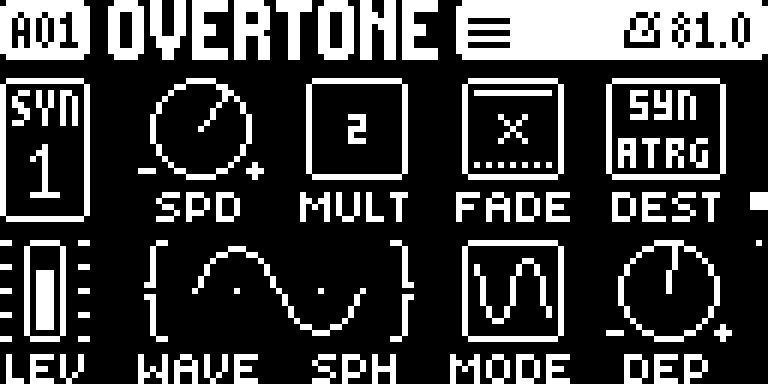

Two followers per sound. On a **[MOD]** page press **RIGHT** for ENV1 (UP / DOWN for ENV2), and **LEFT** to go back
to the LFOs.
- **SRC:** the track it listens to (by default its own).
- **ATK** and **DEC:** how fast it follows.
- **DEST:** what it moves (any parameter, as with LFO DEST).
- **IN** and **OUT:** meters of the input and output levels; turning them sets the gain.
- **THR:** the threshold below which it does nothing.
- **DEP:** the depth, positive or negative.
- Every knob can be p-locked.

### Two arpeggiators

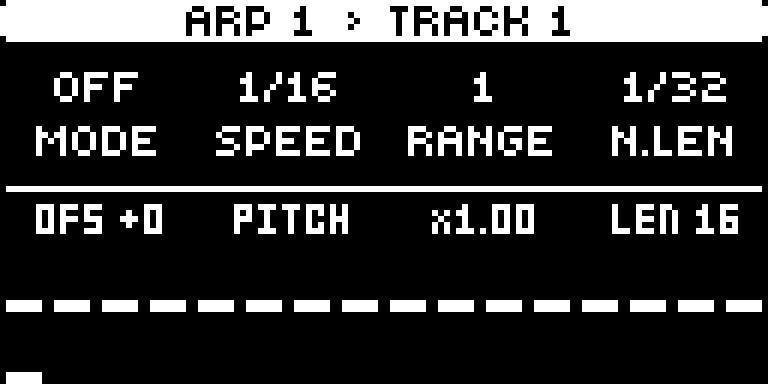 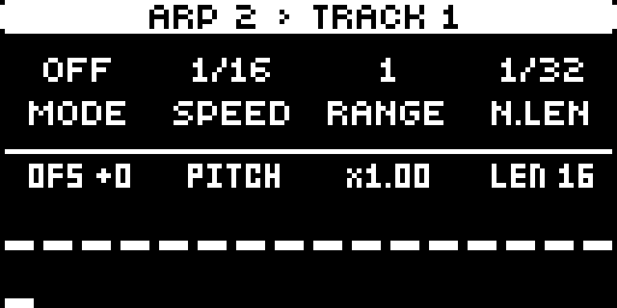

- **ARP 1** is the stock arpeggiator with more controls. The second row:
  - **E OFS:** the selected step's offset (LEFT / RIGHT picks the step).
  - **F DEST:** on **PITCH** the arp plays **in the keyboard scale** (KEYBOARD SETUP: ROOT and SCALE). Anywhere else,
    each step moves that parameter by its offset while the note stays.
  - **G DEP:** on PITCH it stretches or flips the pattern (×−4 to ×4); elsewhere it is the depth.
  - **H LEN.**
  - **UP / DOWN** mutes or unmutes the selected step.
- **ARP 2** is a step modulator: it plays no notes. It restarts at every trig and moves its DEST by each step's
  offset × DEP. On PITCH it adds scale degrees to ARP 1's notes.
- **Keys in the ARP menu:** tap **[ARP]** to switch between ARP 1 and ARP 2. Hold **[ARP]** and press **[YES]** to
  randomize the shown arp. **[FUNC] + [ARP]** or a page key closes the menu.
- **Per trig:** in GRID RECORDING, hold a trig and turn the ARP knobs. That trig's arp uses the locked values, so, for
  example, one trig can arpeggiate while the rest don't. Mutes set on a held trig apply to that trig only.
- **Live recording** records ARP knob moves as locks.

### Cross-modulation

Each sound has two LFOs (**[MOD]**, UP / DOWN), two envelope followers and two arps. Every continuous knob of each of
them is a destination for the others: for example, LFO1 can wobble ARP 1's speed, ARP 2 can step ENV1's depth, and
LFO1 can modulate LFO2's knobs. The DEST lists are grouped: SYN, FX, LFO, Fol (followers), ARP.

### GROOVE

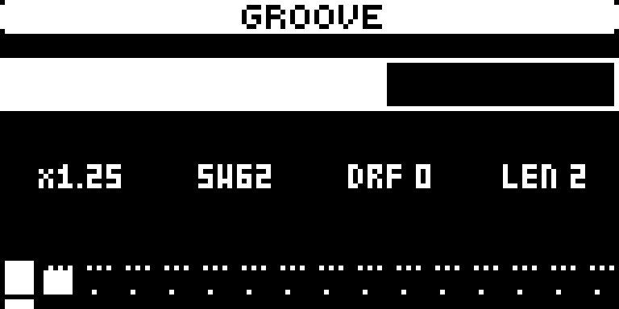 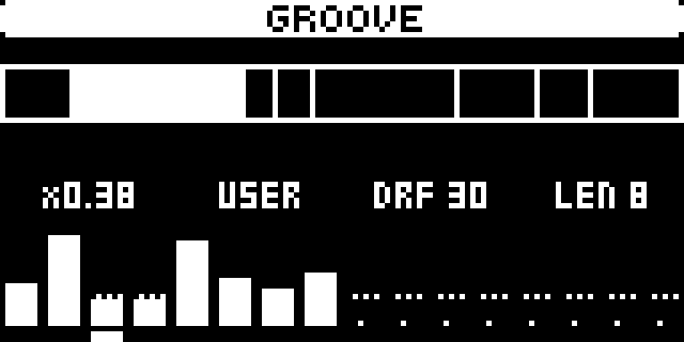

**[TEMPO]** opens the tempo screen; **[TEMPO] again** switches to GROOVE, and once more back to the tempo screen.
GROOVE replaces swing: each step of a cycle gets a **weight**, and the cycle keeps its length, so the bar stays in time.
- **LEVEL** or **LEFT / RIGHT** move the pointer one step. **E** sets that step's weight (1–99, 24 = straight); its label
  shows how long the step lasts compared with straight (×1.50). **UP / DOWN** change the weight by one; held, they repeat.
- **F** picks a preset: STRT, SW54 / SW58 / SW62 / SW66 / SW71 (16th swing), 8S58 / 8S66 (8th swing), PUSH (off-beats
  early), SHFL, LAZY and QUIN. Editing a weight or the length shows USER.
- **G** sets **DRIFT** (0–99): every cycle each weight moves by a new random amount, while the cycle's start stays in
  time. DRIFT is also a modulation destination ("Groove Drift", at the end of the DEST lists) for the LFOs, envelope
  followers and arps.
- **H** sets the cycle's length (1–16 steps).
- **Hold [TEMPO] and press [YES]** for random weights (the length stays). Release [TEMPO] and hold it again for another.
- The top row shows the cycle as it plays, each step a box as wide as its time; the playing step's box is filled.
- A cycle starts again at the pattern's start. GROOVE times every track and the arpeggiators, and it is saved with the
  pattern.

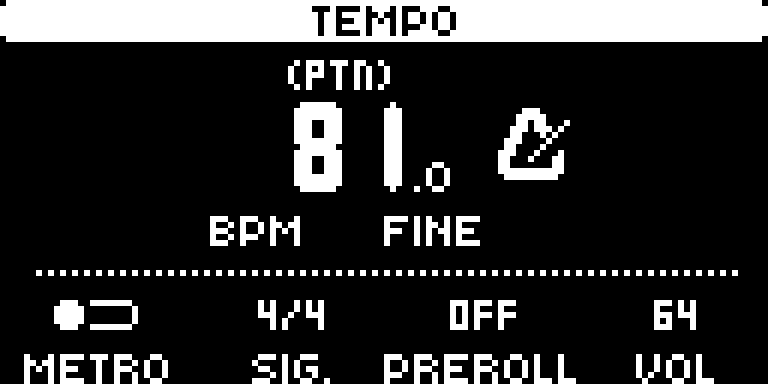

The tempo screen has no SWING. **[FUNC] + [TEMPO]** is tap tempo, as on Elektron's OS.

### Parameter slides

On **TRIG page 2**, **SLD** turns on a slide for the trig and **SLEN** sets its length, in steps. Every parameter the trig
changes (its p-locks, or the sound's values) glides from where the track was to the new value, insert effects included.
Turning a knob by hand acts at once.

### Knobs that show what is playing

While the sequencer runs, the knobs on the sound pages show the value that is actually playing: p-locks, slides and
LFO / follower / arp movement, not only the value you set. The filter's FREQ follows the filter envelope too. Holding a
page key shows the set values as numbers. Holding a trig shows that trig's locks so you can edit them.

### DSP load

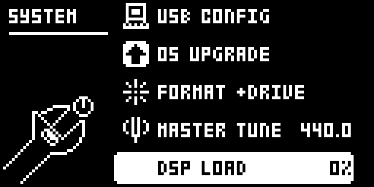 SYSTEM > DSP LOAD">

**[SETTINGS] > SYSTEM > DSP LOAD** shows how busy the sound engine is. LOOP, SOPHIE and MACHINEDRUM voices cost more than
the stock machines. When it reaches 100 % the audio crackles: use fewer voices.

## Install

You need a Digitone II, a computer with **Python 3.11 or later** (macOS, Windows or Linux), a USB cable and
**Elektron Transfer**.

1. **Back up** your projects and the +Drive with Elektron Transfer.
2. **Get Python** if you don't have it: [python.org/downloads](https://www.python.org/downloads/). On a Mac, check with
   `python3 --version` in Terminal.
3. **Get Elektron's OS 1.12.** On [Elektron's download page](https://elektron.se/support-downloads/digitone-ii),
   download **Digitone II OS 1.12** (`Digitone_II_OS1.12_dist.zip`). **Keep this file:** Elektron's page lists only
   the current OS, and you need it to go back or to make another build.
4. **Download Overtone** from [Releases](../../releases) (`overtone-1.1.zip`) and unzip it.
5. **Make the build.** In a terminal, in the unzipped folder:

   ```bash
   python3 patcher/patch.py ~/Downloads/Digitone_II_OS1.12_dist.zip
   ```

   It checks that the file is Elektron's original OS 1.12, rebuilds Overtone from it in 1 to 3 minutes, and saves
   `Overtone-1.1.syx` next to the .zip, but only if the result is byte for byte the tested build. The .zip, its
   unzipped folder and the .syx all work as input.
6. **Send it to the Digitone.** Connect it over USB, open Transfer, drag `Overtone-1.1.syx` onto it, answer **YES** on
   the Digitone and wait for it to restart.

## Going back, and recovery

- **Back to Elektron's OS:** send Elektron's `Digitone_II_OS1.12.syx` (inside the .zip) with Transfer, the same way.
  Overtone installs it by itself, without asking for YES.
- **Updating Overtone:** send the new build with Transfer the same way.
- **On Overtone 1.0:** an OS sent with Transfer stops on **Receiving** or **PREPARING...** and nothing is written:
  switch the Digitone off and on. To update from 1.0, go back to Elektron's OS with the STARTUP menu below, then
  send the new build with Transfer.
- **If the Digitone doesn't start:**
  1. Hold **[FUNC]** while you switch it on. The STARTUP menu appears.
  2. Press **[TRIG 4]** (OS UPGRADE).
  3. In Transfer, use **LEGACY OS UPGRADE** mode and send Elektron's `Digitone_II_OS1.12.syx` over a **DIN MIDI** cable.
     USB doesn't work in the STARTUP menu. It takes about 15 minutes.

  Overtone never changes the bootstrap that holds this menu.

## Compatibility

- **Digitone II, OS 1.12 only.** The patcher refuses any other file.
- **Projects** stay in Elektron's format. Overtone's settings live in spare space in the sound, the pattern's lock table
  and values the stock OS doesn't use. **LFO 3's storage holds ARP 2:** a sound that used LFO 3 loses it.
- **Swing** is gone. A project's saved swing is ignored, and GROOVE takes its place.
- **Opening Overtone projects on Elektron's OS** is not tested. Keep a copy.
- **An OS sent over USB installs without a confirmation** on the unit (Transfer included).

## Known limitations

- **The Overbridge plugin** knows only Elektron's names and ranges.
- **GROOVE** is global for now (per track is planned). Tempo-synced LFOs and delays follow the BPM, not the groove, and
  an external MIDI clock is not warped by it.
- **PRE FLTR inserts** use two voices per note on that track.
- **Heavy machines** (LOOP in STRC mode, P-I, many SOPHIE voices) can push the DSP over 100 %. Watch DSP LOAD.
- **ENV3 and LFO3** don't exist any more: their storage holds ENV2 and ARP 2.

## How it's made and tested

Overtone was developed with [Claude Code](https://claude.com/claude-code) and the
[digitone-2-modding-skill](https://github.com/complex-ping/digitone-2-modding-skill). Every build runs a suite of
about 160 checks in two emulators before it reaches a unit:
- the Digitone's real main OS in [digikit](https://github.com/m-dwyer/digikit);
- the DSP program in a SHARC emulator.

Overtone 1.1 is played on a Digitone II; its tested base passed every check. Installing with Transfer, from Elektron's OS and
from Overtone, was checked on the unit.

The patcher (`patcher/patch.py`) needs only Python. It holds Overtone's changes as copy instructions over your own file,
plus Overtone's own bytes. Every 16-byte run inside those bytes is checked against Elektron's OS 1.12 file, and none of them is in
it. It seals the build with the key it derives from your file, as the Digitone expects.

## Versions

- **1.1** (30 Oct 2026): GROOVE reworked: a second [TEMPO] opens it, presets on F, DRIFT on G (a new random
  offset every cycle, also a modulation destination), [TEMPO] + [YES] random weights, arrows to edit, the playing step
  lit. [FUNC] + [TEMPO] is tap tempo again.
- **1.0.1** (29 Oct 2026): an OS sent with Transfer while Overtone runs now installs (1.0 stopped on Receiving or
  PREPARING...). Nothing else changed.
- **1.0** (29 Oct 2026): the first release.

## Credits

- **[dnfw](https://github.com/angellinares/dn2_firmware_explore)** (angellinares): the firmware container, the code
  loader and the C build path. `patcher/_dnfw` is its code, unchanged.
- **[elektron-firmware-tool](https://github.com/mischa85/elektron-firmware-tool)** (Marcel Bierling): the container
  format that dnfw follows.
- **[digikit](https://github.com/m-dwyer/digikit)** (Em D): the ColdFire emulator every build is tested in.
- **[Schwung Sophie](https://github.com/mestela/schwung-sophie)** (Matt Estela, digisophie contributors; MIT): the
  SOPHIE machine.
- **[gearmulator](https://github.com/dsp56300/gearmulator)**: its DSP56300 emulator ran the Machinedrum and Monomachine
  references the ports were compared against.
- **Elektron's Machinedrum and Monomachine**: the MACHINEDRUM machine and the PHSR, CHOR and REVB inserts are ports of
  their sound engines.
- [naturarum/dn2-cfw](https://github.com/naturarum/dn2-cfw) (Digiwerk) showed how to ship Digitone II firmware as a
  patcher.

Made by [complex-ping](https://github.com/complex-ping) with Claude, Anthropic's AI model, in Claude Code.

## Licence

AGPL-3.0-or-later (the patcher includes dnfw, which is AGPL). See [LICENSE](LICENSE).

Elektron, Digitone, Machinedrum, Monomachine and Overbridge are trademarks of Elektron Music Machines. Overtone is not
made or supported by Elektron, and not affiliated with or endorsed by it.
